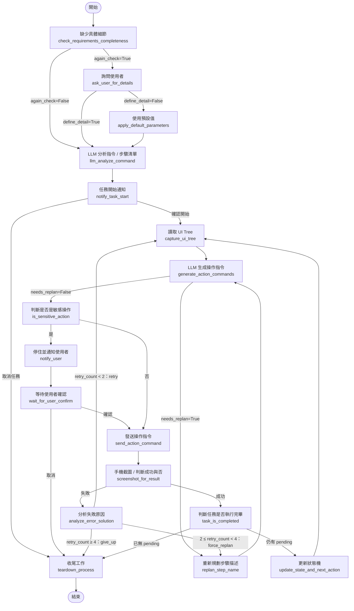

# LangGraph 狀態機設計文件（依後端現況更新版）

> 本文件已依 `Server_Core.zip` 內的後端程式碼同步更新：`LangGraph_Core.py`、`Action.py`、`FormatOutput.py`、`Connection_Manager.py`、`communication.py`、`Server_Core.py`、`logging_utils.py`。
> 與程式碼尚有落差、建議修正之處，統一整理在文末「附錄：與程式碼的已知落差」，文中以 ⚠️ 標示。

---

## 後端檔案架構

| 檔案 | 角色 | 說明 |
|---|---|---|
| `Server_Core.py` | 通訊層入口 | FastAPI + WebSocket（`/ws`，port 8002）。連線建立後先收一則 `Initial_messages`，接著以 `asyncio.create_task` 啟動 `run_agent`，並持續 `receive_loop` 把收到的 JSON 丟進 `manager` |
| `Connection_Manager.py` | 橋接層 | `ConnectionManager`：持有 websocket 與 `asyncio.Queue`；提供 `send_*` 系列送出函式與 `wait_for_user(expected_type)`（依 `type` 取訊息，不符者放回佇列尾端） |
| `communication.py` | 通訊格式 | 後端 → APP 的 Pydantic JSON 定義，所有訊息帶 `sent_time`（Asia/Taipei） |
| `Action.py` | 資料結構 | `PlanStep`、`BoundsXY`、`Action` |
| `FormatOutput.py` | LLM 輸出格式 | 所有 `with_structured_output` 使用的 Pydantic 類別 |
| `LangGraph_Core.py` | 核心 | State、全部節點、圖的建構、`run_agent` |
| `logging_utils.py` | 記錄 / 除錯 | `logged_node` 裝飾器、`export_task_json`、終端機輸出擷取（`terminal_output.log`） |

- LLM：透過 `init_chat_model("gpt-5.4-mini", max_retries=5)` 初始化，各節點以 `with_structured_output(...)` 讓模型依指定格式輸出。
- 多模態：凡是需要看畫面的節點（生成操作指令、重新規劃、判斷成功與否、分析失敗原因），都會同時送入 **UI Tree + 螢幕截圖**（`build_image_blocks`）。

---

## 節點清單

| 節點名稱 | 程式函式 | 類型 | 說明 |
|---|---|---|---|
| 開始 | `START` | 起點 | 任務啟動 |
| 缺少具體細節（分析是否缺少具體需求） | `check_requirements_completeness` | LLM 節點 + 等待 APP | **先等待 APP 傳來 `first_messages`**（使用者原始指令）存入 `user_command`，再由 LLM 判斷是否缺少「真正需要詢問」的細節。需詢問時，將彙總後的問題以 `ask_user` 送給 APP，並把問答寫入 `messages` |
| 詢問使用者 | `ask_user_for_details` | Human-in-the-loop | 等待 APP 回傳 `detail_response`；LLM 判斷使用者是否「明確說明」（`define_detail`）。有明確說明則再由 LLM 轉成 dict 存入 `clarified_params`；無明確說明則 `clarified_params` 維持 `None` |
| 使用預設值 | `apply_default_parameters` | LLM 節點 | 使用者沒有明確說明時，由 LLM 依原始指令填入大多數人會選的預設值，存入 `clarified_params` |
| LLM 分析指令 / 回傳步驟清單 | `llm_analyze_command` | LLM 節點 | 依 `user_command` + `clarified_params` 產生步驟計畫 `plan`（每步含 `step_id` / `step_name` / `status` / `note`，粒度須細到「單一指令可完成」），並把 `current_step_id` 指向第一步。不預先生成操作指令 |
| 任務開始通知 | `notify_task_start` | Human-in-the-loop | 送 `task_start` 給 APP，等待 `user_confirm_start`（欄位 `user_confirm`）。確認 → 主迴圈；取消 → teardown |
| 讀取 UI Tree | `capture_ui_tree` | 執行節點 | 先 `sleep(3)` 等畫面穩定 → 送 `read_ui` → 等待 `ui_screen_data`。APP 回傳 `{screenWidth, screenHeight, coverageRatio, uncoveredRegions, root}` 與操作前截圖。**Tree 本體（`root`）存入 `current_ui_tree`，其餘覆蓋率資訊存入 `ui_tree_meta`，截圖存入 `before_screenshot_base64`** |
| LLM 生成操作指令 | `generate_action_commands` | LLM 節點 | 輸入：原始需求、`clarified_params`、當前步驟名稱、plan 中尚未完成的其他步驟、上一輪失敗原因與提示（若有）、覆蓋率提醒、UI Tree、截圖。輸出：`current_action`，以及三種情境旗標（見下方「LLM 生成操作指令的三種情境」） |
| 重新規劃步驟描述 | `replan_step_name` | LLM 節點 | **新增節點**。當步驟「寫錯 / 做不到」或「連續失敗」時，依畫面現況修改 `plan`：`replace` / `insert_before` / `insert_after` / `skip`，或偵測到畫面進度已超前而直接跳到後面某個 `step_id`。處理完回到「LLM 生成操作指令」（不重新讀取 UI Tree） |
| 判斷是否是敏感操作 | `is_sensitive_action` | LLM 節點 | 依「步驟名稱 + action_type / resource_id / content_description / input_text」判斷是否為敏感操作（付款、確認訂單、送出表單、輸入密碼、刪除資料等），並寫入原因 |
| 停住並通知使用者 | `notify_user` | Human-in-the-loop | 送 `action_check` 給 APP：訊息含「步驟名稱、操作類型、（若有）輸入內容」與 `sensitive_reason` |
| 等待使用者確認 | `wait_for_user_confirm` | Human-in-the-loop | 等待 APP 回傳 `sensitive_confirm`（欄位 `request_response`，True 確認 / False 取消） |
| 發送操作指令 | `send_action_command` | 執行節點 | 送 `operate_command`（內含 `current_action`）給 APP，由 APP 的 AccessibilityService 執行 |
| 手機截圖後回傳 / 判斷成功與否 | `screenshot_for_result` | 執行節點 + LLM 節點 | APP 執行完會**主動**回傳 `ui_screen_data`（後端不另送 `read_ui`）。LLM 比對「操作前後的 UI Tree + 操作前後截圖」與步驟名稱、操作指令，輸出 `is_success` |
| 分析失敗原因 / 提供解決方法 | `analyze_error_solution` | 錯誤處理 | LLM 分析失敗原因與下一輪提示；`retry_count + 1`、`error_reason` append、寫入 `next_round_hint`，並寫入 `replan_reason`（供強制重規劃使用） |
| 判斷任務是否執行完畢 | `task_is_completed` | 執行節點 | 把當前步驟在 `plan` 中標記為 `done`（若為例外步驟 `not_current_step` 則不標記）；之後由條件邊檢查 plan 是否已無 `pending` |
| 更新狀態機 / 執行下個步驟 | `update_state_and_next_action` | 執行節點 | 清除動態欄位，`current_step_id` 指向 plan 中第一個 `pending` 步驟，`retry_count` 歸零 |
| 收尾工作 / teardown | `teardown_process` | 收尾節點 | 判定任務結果、送 `task_cancel`（僅在開始前取消時）與 `task_end` 給 APP、清理 state、匯出 log |
| 結束 | `END` | 終點 | 所有路徑的唯一出口 |

### LLM 生成操作指令的三種情境

`generate_action_commands` 每次只輸出**唯一一個**操作指令，並判斷屬於以下哪一種（三者互斥）：

| 情境 | 旗標 | 處理 |
|---|---|---|
| 一般：步驟可正常執行 | `not_current_step=False`、`needs_replan=False` | 依步驟生成操作指令 |
| 一：畫面上有東西擋住（廣告、彈窗等） | `not_current_step=True`、`needs_replan=False` | 生成「關閉彈窗」的指令，並產生臨時步驟名稱 `exception_step_name`；**不消耗 plan 步驟**，執行後該 plan 步驟仍維持 `pending`，下一輪再重新感知畫面後繼續 |
| 二：目前步驟本身無法達成（畫面上根本沒有該選項 / 元件） | `needs_replan=True`、`replan_reason` 簡述原因 | 不硬點其他元件、不編造座標；轉往 `replan_step_name` |

---

## 邊（Edge）與條件

```
開始
  └─────────────────────────────→ 缺少具體細節（check_requirements_completeness）

缺少具體細節
  ├── again_check = True ──────→ 詢問使用者
  └── again_check = False ─────→ LLM 分析指令 / 回傳步驟清單

詢問使用者
  ├── define_detail = True ────→ LLM 分析指令 / 回傳步驟清單
  └── define_detail = False ───→ 使用預設值

使用預設值
  └─────────────────────────────→ LLM 分析指令 / 回傳步驟清單

LLM 分析指令 / 回傳步驟清單
  └─────────────────────────────→ 任務開始通知

任務開始通知
  ├── user_confirm_start = True ─→ 讀取 UI Tree（主迴圈入口，第一次感知畫面）
  └── user_confirm_start = False → 收尾工作 / teardown

讀取 UI Tree
  └─────────────────────────────→ LLM 生成操作指令

LLM 生成操作指令
  ├── needs_replan = True ─────→ 重新規劃步驟描述
  └── needs_replan = False ────→ 判斷是否是敏感操作

重新規劃步驟描述
  └─────────────────────────────→ LLM 生成操作指令（畫面沒變，不重新讀取 UI Tree）

判斷是否是敏感操作
  ├── is_sensitive = True ─────→ 停住並通知使用者
  └── is_sensitive = False ────→ 發送操作指令

停住並通知使用者
  └─────────────────────────────→ 等待使用者確認

等待使用者確認
  ├── is_confirmed = True ─────→ 發送操作指令
  └── is_confirmed = False ────→ 收尾工作 / teardown

發送操作指令
  └─────────────────────────────→ 手機截圖後回傳 / 判斷成功與否

手機截圖後回傳 / 判斷成功與否
  ├── is_success = True ───────→ 判斷任務是否執行完畢
  └── is_success = False ──────→ 分析失敗原因 / 提供解決方法

分析失敗原因 / 提供解決方法（retry_count 已 +1）
  ├── retry_count < 2 ─────────→ 讀取 UI Tree（retry：重新感知畫面後重試）
  ├── 2 ≤ retry_count < 4 ─────→ 重新規劃步驟描述（force_replan：強迫換做法）
  └── retry_count ≥ 4 ─────────→ 收尾工作 / teardown（give_up：放棄）

判斷任務是否執行完畢
  ├── plan 中已無 pending 步驟 ─→ 收尾工作 / teardown
  └── 仍有 pending 步驟 ────────→ 更新狀態機 / 執行下個步驟

更新狀態機 / 執行下個步驟
  └─────────────────────────────→ 讀取 UI Tree（下一步從這裡重新感知畫面）

收尾工作 / teardown
  └─────────────────────────────→ 結束
```

### 流程圖（Mermaid）



---

## 重新規劃（replan）機制說明

`replan_step_name` 有兩個進入點：

1. **步驟本身做不到**：`generate_action_commands` 回報 `needs_replan=True`。
2. **連續失敗**：`analyze_error_solution` 後 `retry_count` 介於 2～3，強制換做法而不是重送類似指令（此時 `replan_reason` 為「連續執行失敗：{失敗原因}」）。

LLM 收到：原始需求、補全參數、需重規劃的步驟、原因、整份 plan、**當前 UI Tree 與截圖**，輸出 `FormatOutput_replan`：

| 欄位 | 說明 |
|---|---|
| `matches_later_step_id` | **優先判斷**。若畫面進度其實已超過目前步驟（現在該做的事就是 plan 後面某個 pending 步驟的內容），填入該 `step_id`。系統會把目前步驟到該步驟之前的所有步驟標記為 `done`（`note` 註明為「推測已完成」），並將 `current_step_id` 直接跳過去 |
| `action` | `replace`（改寫描述）/ `insert_before`（之前插入新步驟）/ `insert_after`（之後插入新步驟）/ `skip`（標記為 `skipped`）。優先使用 `replace` |
| `target_step_id` | 要處理的步驟；對不到時退回原本要重規劃的那一步 |
| `new_step_name` | 新描述；**必須是「依目前畫面、現在就能執行的單一具體動作」**，禁止寫成「若…就…，若沒有就…」的條件句，也不要一次規劃好幾個畫面之後的步驟 |
| `reason` | 寫入該步驟的 `note`，供除錯 |

新插入的步驟會用「現有最大編號 + 1」產生新的 `step_id`，不會與既有步驟撞名。處理完畢後 `needs_replan`、`replan_reason` 會被清為 `None`。

---

## State 欄位設計

```python
from typing import Annotated
from typing_extensions import TypedDict
from pydantic import BaseModel
from langgraph.graph.message import add_messages
import operator

class PlanStep(TypedDict):      # LLM 生成步驟清單的規範（Action.py）
    step_id: str                # 穩定 ID，例如 "s3"，不受插入/刪除影響
    step_name: str              # 步驟描述
    status: str                 # "pending" | "done" | "skipped" | "failed"
    note: str | None            # 若被 replan 過，記錄原因

class BoundsXY(BaseModel):
    x: int      # 元件中心點 X（node.x + node.width // 2）
    y: int      # 元件中心點 Y（node.y + node.height // 2）

class Action(BaseModel):            # 每次根據 UI tree 生成的操作指令
    """操作指令細節"""
    action_type: str                # "click" / "set_text" / "scroll" / "global_back"
    full_resource_id: str | None    # 完整 ViewId
    resource_id: str | None         # 優先使用，來自 UiNode.resourceId
    content_description: str | None # 次選：桌面圖示、無障礙標籤、resource_id 重複或為通用值時
    hint_text: str | None           # 節點的 hint 與 content_description 分開
    text: str | None                # 節點的 text
    bounds: BoundsXY | None         # 元件中心點座標（目前規則：一律填入，見 Action 欄位說明）
    input_text: str | None          # 僅 set_text 時使用
    scroll_direction: str | None    # 僅 scroll 時使用："up"/"down"/"left"/"right"

class State(TypedDict):
    """狀態表，狀態機核心記憶體"""
    user_command: str | None                 # 使用者原始指令
    again_check: bool | None                 # 是否再詢問使用者一次的變數
    messages: Annotated[list, add_messages]  # 所有對話紀錄
    define_detail: bool | None               # 判斷是否有明確說明
    clarified_params: dict | None            # 補全的參數（詢問使用者或使用預設值後填入）
    user_confirm_start: bool | None          # 使用者確認 開始/取消 任務
    # 上面的變數為前置處理所需
    plan: list[PlanStep]                     # 步驟計畫（取代舊版 total_step）
    current_step_id: str | None              # 目前步驟的 step_id（取代舊版 current_step index）
    current_ui_tree: dict | None             # 每步執行前讀入（只放 Tree 本體，即 APP 回傳的 root）
    ui_tree_meta: dict | None                # screenWidth / screenHeight / coverageRatio / uncoveredRegions
    current_action: Action | None            # LLM 根據 UI Tree 生成，執行完後清除
    last_ui_tree: dict | None                # 操作「後」回傳的 UI Tree（供失敗分析、除錯用）
    retry_count: int                         # 當前步驟的失敗重試次數（換步驟時歸零）
    is_success: bool | None                  # 當前步驟是否執行成功
    is_sensitive: bool | None                # 是否為敏感操作
    sensitive_reason: str | None             # 該操作為敏感操作的原因
    is_confirmed: bool | None                # 敏感操作：使用者確認為 True，取消為 False
    not_current_step: bool | None            # 本次操作不屬於 plan 內的步驟（彈窗等），True 時不消耗 plan 步驟
    exception_step_name: str | None          # not_current_step 為 True 時生成的臨時步驟名稱
    needs_replan: bool | None                # 生成指令時判斷「這步寫錯 / 做不到」為 True
    replan_reason: str | None                # 需要重新規劃的原因
    before_screenshot_base64: str | None     # 每步驟執行前的螢幕截圖
    after_screenshot_base64: str | None      # 執行後的螢幕截圖
    # 上面為主執行流程所需
    task_result: str | None                  # 任務結果（teardown 寫入）
    error_reason: list[str]                  # 每次失敗原因
    next_round_hint: str | None              # 分析失敗後給下一輪生成操作指令的提示
    execution_log: Annotated[list, operator.add]  # 每個節點執行完 append 一筆紀錄（需 reducer 才能累積）
```

### 初始值

```python
initial_state = {
    "user_command": None,
    "again_check": None,
    "messages": [],
    "define_detail": None,
    "clarified_params": None,
    "user_confirm_start": None,
    "plan": [],
    "current_step_id": None,
    "current_ui_tree": None,
    "ui_tree_meta": None,
    "current_action": None,
    "last_ui_tree": None,
    "before_screenshot_base64": None,
    "after_screenshot_base64": None,
    "retry_count": 0,
    "is_success": None,
    "is_sensitive": None,
    "sensitive_reason": None,
    "is_confirmed": None,
    "not_current_step": None,
    "exception_step_name": None,
    "needs_replan": None,
    "replan_reason": None,
    "task_result": None,
    "error_reason": [],
    "next_round_hint": None,
    "execution_log": [],
}
```

### 欄位說明

| 欄位 | 型別 | 初始值 | 說明 |
|---|---|---|---|
| `user_command` | `str \| None` | `None` | 由「缺少具體細節」節點在收到 APP 的 `first_messages` 後寫入，全程不變 |
| `again_check` | `bool \| None` | `None` | `True` = 需向使用者詢問細節，`False` = 資訊足夠可繼續。判斷標準：該細節有多個合理選項、無法從指令推斷、且選錯代價不小才算缺少；「該用哪個 APP」與有業界慣例的選項**不算**缺少 |
| `messages` | `Annotated[list, add_messages]` | `[]` | LangGraph 自動 append。前置處理階段會寫入使用者指令、詢問訊息與使用者回覆 |
| `define_detail` | `bool \| None` | `None` | 使用者回覆是否明確說明缺少的細節，有則為 `True` |
| `clarified_params` | `dict \| None` | `None` | 詢問使用者後由 LLM 轉成 dict 填入，或由「使用預設值」節點填入；之後會被帶進「分析指令」「生成操作指令」「重新規劃」的 prompt |
| `user_confirm_start` | `bool \| None` | `None` | `True` = 確認開始，`False` = 取消任務並路由至 teardown |
| `plan` | `list[PlanStep]` | `[]` | 步驟計畫。步驟會隨執行更新 `status` / `note`，也可能被 replan 改寫、插入或跳過 |
| `current_step_id` | `str \| None` | `None` | 目前要執行步驟的 ID（例如 `"s3"`）；用 ID 定位，不受插入 / 刪除影響。步驟完成或 replan 後會重新指向下一個 `pending` 步驟 |
| `current_ui_tree` | `dict \| None` | `None` | 只放 Tree 本體（`root`），每步執行前由 APP 讀取；步驟完成後清除 |
| `ui_tree_meta` | `dict \| None` | `None` | APP 回傳的畫面尺寸與覆蓋率資訊。若覆蓋率不足且有 `uncoveredRegions`，會組成「覆蓋率提醒」插入 prompt，避免 LLM 把「Tree 找不到節點」誤判成「畫面上沒有這個東西」（常見於廣告、WebView、自繪 Canvas），改以截圖位置推算 `bounds` |
| `current_action` | `Action \| None` | `None` | LLM 根據步驟名稱、UI Tree、截圖動態生成；步驟完成後清除 |
| `last_ui_tree` | `dict \| None` | `None` | 操作**後**回傳的 UI Tree，供失敗分析與除錯；步驟完成後清除 |
| `before_screenshot_base64` | `str \| None` | `None` | 操作前截圖（讀取 UI Tree 時一併接收），送給各 LLM 節點當主要視覺依據 |
| `after_screenshot_base64` | `str \| None` | `None` | 操作後截圖（判斷成功與否時接收），供成功判斷與失敗分析使用 |
| `retry_count` | `int` | `0` | 每次失敗 +1，**換下一個步驟時歸零**。`<2` 重試；`2~3` 強制重規劃；`≥4` 放棄 |
| `is_success` | `bool \| None` | `None` | 當前步驟執行結果；`False` 且 `error_reason` 有值時，下一輪生成指令會帶入失敗原因與提示 |
| `is_sensitive` | `bool \| None` | `None` | `True` = 敏感操作，需通知使用者確認 |
| `sensitive_reason` | `str \| None` | `None` | 判定原因，推送通知時一併顯示 |
| `is_confirmed` | `bool \| None` | `None` | 敏感操作確認結果；`None` = 尚未詢問，`True` = 確認，`False` = 取消 |
| `not_current_step` | `bool \| None` | `None` | `True` = 本次操作屬於例外處理（彈窗、廣告等），不計入 plan 進度，也不會把當前步驟標為 `done` |
| `exception_step_name` | `str \| None` | `None` | 例外操作的臨時步驟名稱；`not_current_step=True` 時，`get_current_step_name()` 會優先使用它（供敏感判斷、通知、成功判斷、失敗分析使用） |
| `needs_replan` | `bool \| None` | `None` | 生成指令時發現步驟做不到而填 `True`，路由至 `replan_step_name`；replan 完成後清為 `None` |
| `replan_reason` | `str \| None` | `None` | 重新規劃原因：可能來自生成指令節點（步驟做不到），或失敗分析節點（連續失敗） |
| `task_result` | `str \| None` | `None` | teardown 寫入：`"任務成功"` / `"任務已取消"` / `"任務失敗"` |
| `error_reason` | `list[str]` | `[]` | 每次失敗時 append 的原因，供下一輪生成指令與 teardown 使用 |
| `next_round_hint` | `str \| None` | `None` | 失敗分析節點寫入，下一輪「LLM 生成操作指令」作為額外提示 |
| `execution_log` | `Annotated[list, operator.add]` | `[]` | `logged_node` 在每個節點執行完 append 一筆（節點名稱、時間、耗時、state 快照）。**必須宣告 `operator.add` reducer 才能正確累積**。受 `logging_utils.ENABLE_EXECUTION_LOG` 開關控制，目前為 `False`（永遠是空 list） |

### PlanStep 欄位說明

| 欄位 | 型別 | 說明 |
|---|---|---|
| `step_id` | `str` | 穩定 ID，初始依序為 `s1`、`s2`、`s3`…；replan 插入新步驟時接續使用更大的編號 |
| `step_name` | `str` | 步驟的意圖描述，粒度需細到單一指令可完成（例如輸入文字要拆成「點擊搜尋框」與「輸入關鍵字」兩步）；操作指令不預先寫死，而是根據步驟名稱與當下 UI Tree 動態生成 |
| `status` | `str` | `pending`（待辦）/ `done`（已完成）/ `skipped`（replan 判定不需要）/ `failed`（⚠️ 目前程式碼未使用）。「已處理」= 非 `pending` |
| `note` | `str \| None` | 初始為 `None`；被 replan 改寫、跳過、或「推測已完成」時，記錄原因 |

### BoundsXY 欄位說明

| 欄位 | 型別 | 說明 |
|---|---|---|
| `x` | `int` | 元件中心點 X 座標，計算方式為 `node.x + node.width // 2` |
| `y` | `int` | 元件中心點 Y 座標，計算方式為 `node.y + node.height // 2` |

### Action 欄位說明

| 欄位 | 型別 | 說明 |
|---|---|---|
| `action_type` | `str` | 操作類型：`"click"` / `"set_text"` / `"scroll"` / `"global_back"` |
| `full_resource_id` | `str \| None` | 完整 ViewId |
| `resource_id` | `str \| None` | 目標元件識別的優先選項，來自 `UiNode.resourceId`；需在當前畫面唯一才填 |
| `content_description` | `str \| None` | resource_id 為通用值（如 `"icon"`）或重複時改填，適用於桌面圖示、無障礙標籤等場景 |
| `hint_text` | `str \| None` | 節點的 hint 文字，與 `content_description` 分開紀錄 |
| `text` | `str \| None` | 節點的 text 內容 |
| `bounds` | `BoundsXY \| None` | 元件中心點座標。**目前 prompt 規則為「不論前面的識別方式有沒有填，一律要填 bounds」**；目標落在 UI Tree 未覆蓋區域時，則依截圖視覺位置自行估算 |
| `input_text` | `str \| None` | 僅 `action_type` 為 `"set_text"` 時使用，其餘為 `None` |
| `scroll_direction` | `str \| None` | 僅 `action_type` 為 `"scroll"` 時使用：`"up"` / `"down"` / `"left"` / `"right"` |

目標節點識別規則（依序判斷）：
1. `resource_id` 有值且在當前畫面唯一 → 填 `resource_id`
2. `resource_id` 為通用值或重複 → 改填 `content_description`
3. 不管前兩者是否有填，都要填 `bounds`

---

## 前後端通訊協定

連線：`wss://<host>/ws`。連線建立後 APP 先送一則含 `Initial_messages` 的 JSON，後端隨即啟動 Agent。所有 APP 傳來的 JSON 都進入 `ConnectionManager` 的訊息佇列，各節點以 `wait_for_user(expected_type)` 依 `type` 取用，非預期類型的訊息會被放回佇列尾端。

### 後端 → APP

| `type` | 送出節點 | 欄位 | 用途 |
|---|---|---|---|
| `ask_user` | 缺少具體細節 | `ask_messages` | 詢問缺少的細節 |
| `task_start` | 任務開始通知 | — | 通知 APP 任務即將開始，等待確認 |
| `read_ui` | 讀取 UI Tree | — | 要求 APP 讀取 UI Tree 與截圖 |
| `action_check` | 停住並通知使用者 | `action_detail`、`sensitive_reason` | 敏感操作確認 |
| `operate_command` | 發送操作指令 | `current_action`（Action） | 要 APP 執行操作 |
| `task_cancel` | teardown | `cancel_message` | 僅在「開始前使用者取消」時送出（`"您已取消任務！"`） |
| `task_end` | teardown | `task_result`、`task_process`、`error_reason` | 任務結束：結果、過程摘要、失敗原因 |

每則訊息都另帶 `sent_time`（ISO 格式，Asia/Taipei）。

### APP → 後端

| `type` | 接收節點 | 欄位 | 用途 |
|---|---|---|---|
| `first_messages` | 缺少具體細節 | `first_messages` | 使用者的原始指令 |
| `detail_response` | 詢問使用者 | `detail_response` | 使用者補充的細節 |
| `user_confirm_start` | 任務開始通知 | `user_confirm`（bool） | 確認 / 取消開始 |
| `ui_screen_data` | 讀取 UI Tree、判斷成功與否 | `ui_tree`、`screen_shot`（base64） | 操作前（回應 `read_ui`）與操作後（執行完自動回傳）的畫面資料。`ui_tree` 為 `{screenWidth, screenHeight, coverageRatio, uncoveredRegions, root}` |
| `sensitive_confirm` | 等待使用者確認 | `request_response`（bool） | 敏感操作確認 / 取消 |

> `ui_screen_data` 在兩個節點共用同一個 `type`，靠「節點等待的先後順序」區分是操作前還是操作後。APP 必須在執行完 `operate_command` 後主動回傳一次。

---

## 收尾工作（teardown）說明

所有路徑（正常完成、使用者取消、retry 超限）都會經過 teardown，統一做以下事情：

1. **處理開始前取消**：若 `user_confirm_start == False`，先送 `task_cancel`（「您已取消任務！」）。
2. **判定任務結果** `task_result`：
   - plan 非空且所有步驟皆為已處理（非 `pending`，`done` 與 `skipped` 都算）→ `"任務成功"`
   - 否則若 `is_confirmed` 不為真 → `"任務已取消"`
   - 其餘 → `"任務失敗"`
3. **組過程摘要 `task_process`**：任務總步數、成功執行（`done`）的步數、失敗次數（`retry_count`）。
4. **組失敗原因**：若 `retry_count > 0`，將 `error_reason` 逐筆組成「第 N 次失敗原因：…」。
5. **推送結果給 APP**：送 `task_end`（`task_result`、`task_process`、`error_reason`），APP 據此顯示結果並關閉執行中狀態。
6. **清理 State**：清除 `current_ui_tree`、`ui_tree_meta`、`last_ui_tree`、`current_action`、`is_sensitive`、`sensitive_reason`、`is_confirmed`、`next_round_hint`、`not_current_step`、`exception_step_name`、`needs_replan`、`replan_reason`、前後截圖，並寫入 `task_result`。
7. **匯出 Log**：以「合併 `task_result` 等最終欄位後」的完整 state 呼叫 `export_task_json()`，輸出 `agent_log.json`（內含 `execution_log`）。此功能受 `ENABLE_EXECUTION_LOG` 控制，目前關閉。另外，終端機所有輸出（含 traceback）由 `enable_terminal_capture()` 同步寫入 `terminal_output.log`（去除 ANSI 顏色碼）。

---

## 設計原則

- **任務生命週期完整**：APP 端有明確的兩個信號——「任務開始通知」節點發出開始信號並等待使用者確認（確認進入主迴圈、取消進入 teardown），teardown 節點發出結束信號；兩者之間 APP 端可持續顯示「執行中」狀態
- **單一出口原則**：所有結束情境都經過 teardown，再到結束節點
- **補全前置原則**：資訊缺口在進入 LLM 分析之前解決；只問「有實質選擇且選錯代價不小」的細節，其餘以預設值補齊
- **預設值不擋路**：使用者無明確說明時以合理預設值繼續，不卡住流程
- **感知優先原則**：每個步驟執行前必須先讀取當下的 UI Tree 與截圖，所有操作指令都基於真實畫面狀態動態生成，不預先寫死
- **UI Tree + 截圖雙重感知**：截圖為主要視覺依據、UI Tree 為輔助；並以覆蓋率提醒處理 Tree 抓不到內容（廣告、WebView、自繪畫面）的區域
- **計畫可修正（Plan 不是寫死的）**：步驟以 `step_id` 定位，執行中可由 replan 改寫 / 插入 / 跳過 / 跳步；replan 描述只能是「當下可立即執行的單一動作」，不得寫成條件句，避免把決策延後
- **例外不消耗步驟**：彈窗、廣告等擋路情境以 `not_current_step` 處理，不計入 plan 進度，處理完再回到原步驟
- **敏感判斷後置**：判斷敏感操作在生成 `current_action` 之後進行，LLM 同時看到步驟名稱與實際操作內容，判斷更準確；通知使用者時也能顯示操作細節
- **Retry 重新感知**：一般重試回到讀取 UI Tree，而非直接重送指令，確保 LLM 看到失敗後的最新畫面再決策
- **階梯式失敗處理**：`retry_count` 1 次 → 重試；2～3 次 → 強制重規劃（換做法）；4 次 → 放棄進入 teardown，避免無限循環
- **失敗帶入下一輪**：失敗原因與 `next_round_hint` 會帶入下一輪「生成操作指令」，提示不要重複相同指令
- **Human-in-the-loop 完整**：使用者有確認與取消兩條路，Agent 不擅自執行敏感操作
- **記錄可開關**：節點執行紀錄以 `ENABLE_EXECUTION_LOG` 一鍵開關，不需改動各節點的 `@logged_node` 裝飾器

---

## 附錄：與程式碼的已知落差

以下是比對程式碼時發現、文件已依「實際行為」描述但建議修正的地方：

| # | 位置 | 現象 | 建議 |
|---|---|---|---|
| 1 | `apply_default_parameters` | 回傳的 `clarified_params` 是 `FormatOutput_change_dict.clarified_params_json`（**JSON 字串**），而 `ask_user_for_details` 有 `json.loads` 成 dict。同一欄位型別不一致 | 補上 `json.loads(result.clarified_params_json)` |
| 2 | `teardown_process` 結果判定 | `retry_count ≥ 4` 放棄時，`is_confirmed` 通常為 `None`，`not None` 為真，會被判成 **「任務已取消」而非「任務失敗」** | 改用明確旗標判斷（例如依 `user_confirm_start` / `is_confirmed == False` / retry 超限分別判定） |
| 3 | `generate_action_commands` ↔ `replan_step_name` | `needs_replan` 路徑沒有次數上限，LLM 反覆回報 `needs_replan=True` 且 replan 又沒改變狀況時，可能形成無限迴圈 | 增加 replan 次數計數與上限 |
| 4 | `force_replan` 路徑 | 強制重規劃使用的是**操作前**的 `current_ui_tree` / `before_screenshot`，但失敗後畫面可能已改變，且 replan 後不重新讀取 UI Tree | 評估 force_replan 前先回 `capture_ui_tree`，或改用 `last_ui_tree` / `after_screenshot` |
| 5 | `update_state_and_next_action` | 沒有清除 `error_reason`、`next_round_hint`、`is_success`；`error_reason` 會跨步驟累積，且無「最多 3 筆」限制，teardown 的失敗次數只反映「當前步驟」的 `retry_count` | 步驟成功時清除 `next_round_hint`，並決定 `error_reason` 要全域保留還是每步重置 |
| 6 | `last_ui_tree` | 存的是 APP 原始回傳的 `ui_tree`（含 `root` 與 meta 的外層結構），與 `current_ui_tree`（只含 `root`）格式不同；且 `screenshot_for_result` 沒有像 `capture_ui_tree` 一樣處理「字串需 `json.loads`」的情況 | 統一解析流程，兩處共用同一個解析函式 |
| 7 | LLM 輸出格式描述與 prompt 矛盾 | 生成操作指令、判斷成功、失敗分析、重新規劃的 system prompt 都寫「**截圖為主**」，但 `FormatOutput.py` 的 field description 寫「UI Tree 與截圖衝突時**以 UI Tree 為準**」 | 統一優先順序（建議兩處一致） |
| 8 | `PlanStep.status = "failed"` | 文件與型別都有此值，但程式從未設定 | 移除，或在放棄時將當前步驟標為 `failed` |
| 9 | teardown 失敗訊息 | 舊版文案「已重試 3 次」已不符合現行 4 次放棄的規則；目前 `task_end` 的文案由 `task_result` / `task_process` / `error_reason` 組成，沒有固定的失敗訊息 | 若 APP 端有固定文案，請同步為 4 次 |
| 10 | 非同步阻塞 | 節點內使用同步的 `llm.invoke(...)` 與 `time.sleep(3)`，會阻塞 asyncio event loop（同時也會卡住 WebSocket 收發） | 改用 `await llm.ainvoke(...)` 與 `await asyncio.sleep(3)` |
| 11 | `Server_Core.py` | 每次連線都先把 `agent_started` 重置為 `False` 才檢查，所以「避免重複啟動」的判斷永遠成立；斷線重連會啟動新的 Agent，而舊的 Agent 可能仍在等待佇列 | 視需求保留重置邏輯，或在斷線時取消舊的 Agent task |>